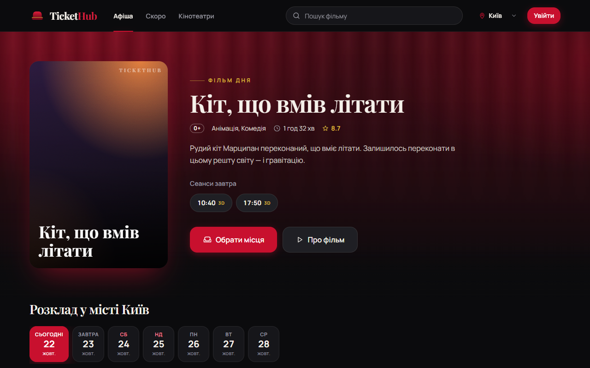
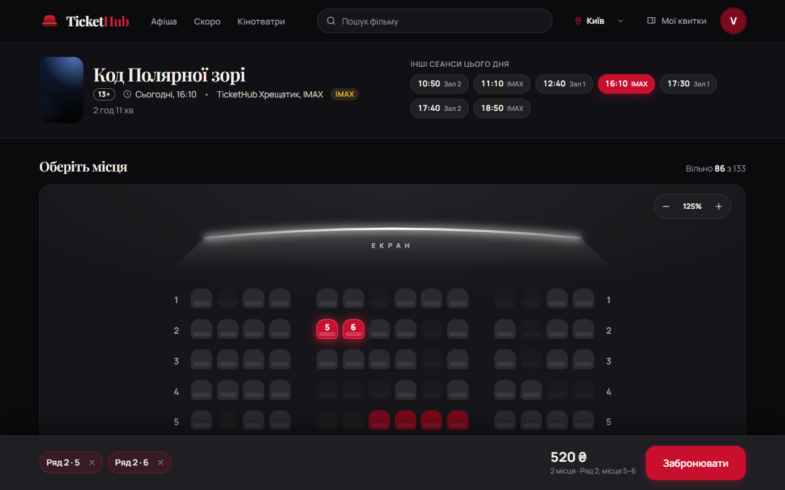
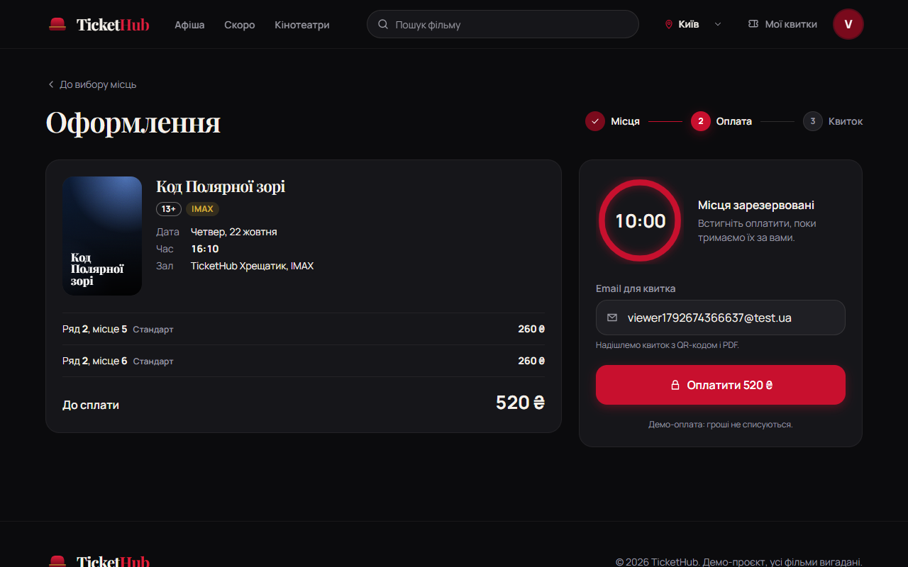
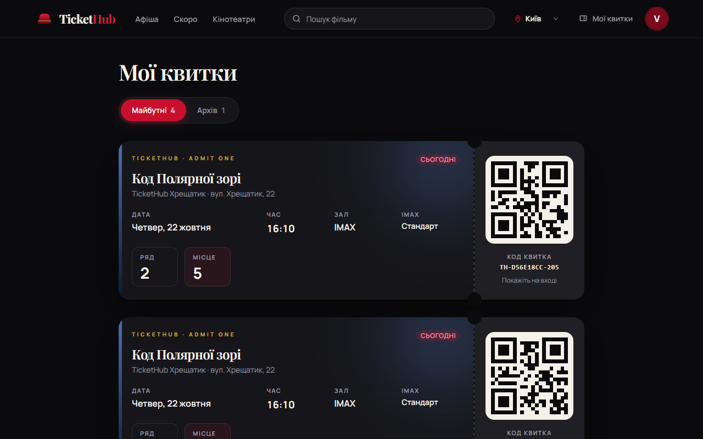
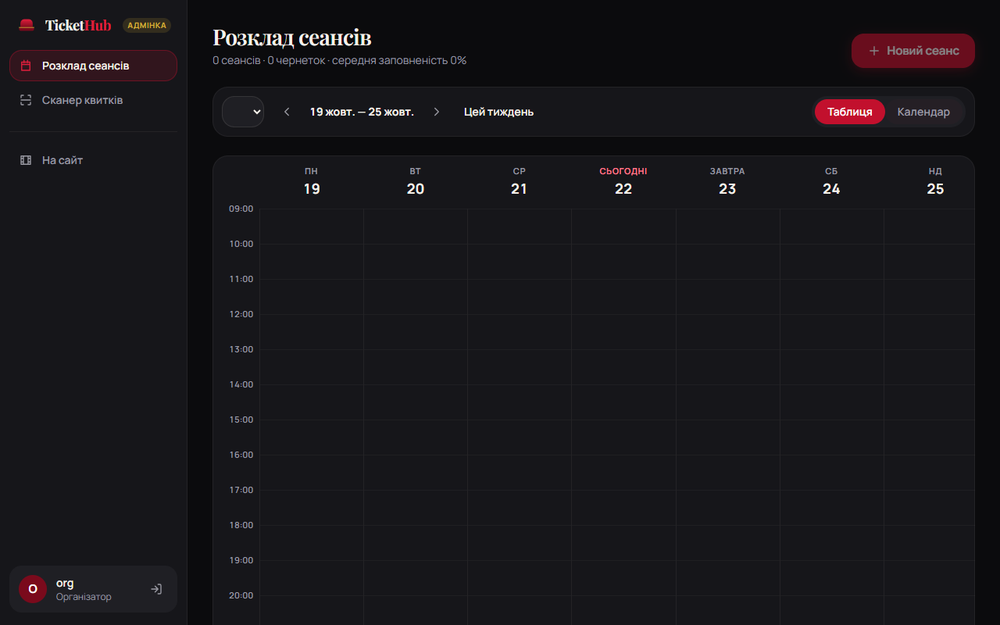
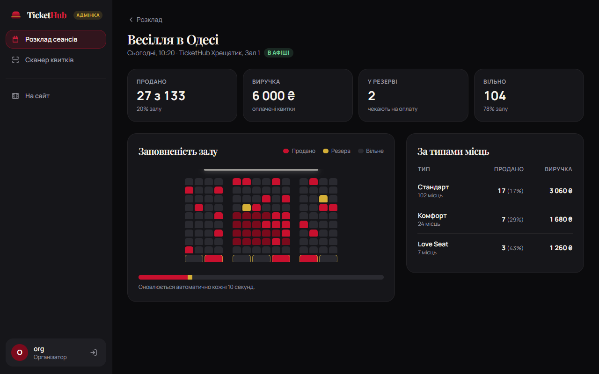
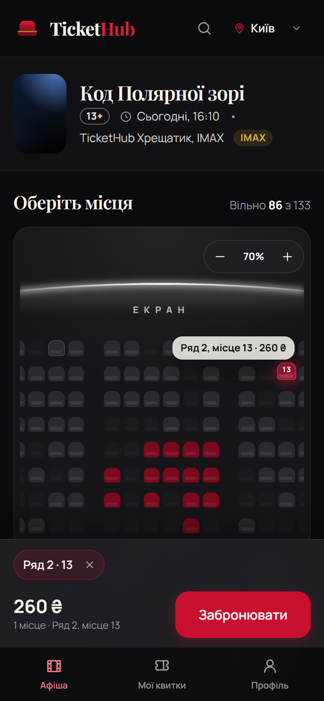

# TicketHub Web

Сайт кінотеатру на Vue 3 поверх TicketHub API: афіша → вибір сеансу → вибір місць у залі → оплата → квиток з QR-кодом. Для організатора — розклад сеансів, статистика продажів і QR-сканер на вході.


**Стек:** Vue 3 (Composition API, `<script setup>`, TypeScript) · Vite · Tailwind CSS · Vue Router · Pinia · Axios · Vitest · Playwright + axe · Docker + nginx.

| Афіша                                            | Вибір місць                                  |
| ------------------------------------------------ | -------------------------------------------- |
|               |  |
| **Оформлення**                                   | **Мої квитки**                               |
|      |       |
| **Адмінка: розклад**                             | **Адмінка: продажі**                         |
|  |  |



## Запуск

```bash
npm install
npm run dev            # http://localhost:5173
```

За замовчуванням сайт працює на **мокових даних** (`VITE_USE_MOCKS=true`): axios-адаптер у `src/api/mock` повністю імітує бекенд — резерви, 409, оновлення токена, оплату із затримкою webhook'а, CRUD сеансів і сканування. Щоб перейти на справжній TicketHub API, задайте `VITE_USE_MOCKS=false` у `.env` (див. `.env.example`); `/api` проксується Vite на `http://localhost:8080`.

**Демо-входи** (будь-який пароль від 6 символів, акаунт створюється автоматично):

| Email     | Роль          | Що доступно                                     |
| --------- | ------------- | ----------------------------------------------- |
| `you@…`   | Глядач        | Бронювання, «Мої квитки» (з парою демо-квитків) |
| `org@…`   | Організатор   | + розклад сеансів, продажі, сканер              |
| `admin@…` | Адміністратор | + зали й генератор схеми місць                  |

## Скрипти

| Команда            | Що робить                                                  |
| ------------------ | ---------------------------------------------------------- |
| `npm run dev`      | Dev-сервер Vite                                            |
| `npm run build`    | `vue-tsc` + production-збірка в `dist/`                    |
| `npm test`         | Юніт- і компонентні тести (Vitest + Vue Test Utils, jsdom) |
| `npm run test:e2e` | E2E на Playwright (десктоп + Pixel 7) з перевіркою axe     |
| `npm run lint`     | ESLint, зокрема правило меж між фічами                     |
| `npm run format`   | Prettier                                                   |
| `npm run gen:api`  | Перегенерувати `src/api/schema.d.ts` зі Swagger бекенду    |

Скриншоти й GIF для README: `SCREENSHOTS=1 npx playwright test screenshots --project=desktop`, потім `booking.webm` конвертується в GIF через ffmpeg.

## Сторінки

| Маршрут                           | Доступ       | Що на сторінці                                                                     |
| --------------------------------- | ------------ | ---------------------------------------------------------------------------------- |
| `/`                               | всі          | «Фільм дня», стрічка дат на 7 днів, фільтри (Усі / 2D / IMAX / Для дітей), постери |
| `/movies/:slug`                   | всі          | Опис фільму, сеанси по днях, згруповані за залом                                   |
| `/sessions/:id`                   | всі          | Схема залу, легенда з цінами, інші сеанси дня, кошик унизу                         |
| `/checkout/:orderId`              | USER         | Кроки, підсумок замовлення, email, круговий таймер резерву, оплата                 |
| `/checkout/:orderId/result`       | USER         | Опитування статусу до `PAID`, анімація квитка                                      |
| `/me/tickets`                     | USER         | Квитки з перфорацією та QR, майбутні й архів                                       |
| `/login`, `/register`, `/profile` | гості / USER | Автентифікація з поверненням туди, де був користувач                               |
| `/soon`, `/cinemas`               | всі          | Анонси та список кінотеатрів                                                       |
| `/admin/sessions`                 | ORGANIZER    | Розклад таблицею й календарем, створення, публікація, перевірка перетину сеансів   |
| `/admin/sessions/:id/sales`       | ORGANIZER    | Заповненість міні-картою залу, виручка за типами місць, автооновлення              |
| `/admin/scan`                     | ORGANIZER    | Повноекранний QR-сканер камерою + ручне введення; зелений — дійсний, рожевий — ні  |
| `/admin/halls`                    | ADMIN        | Генератор схеми залу: ряди, ширина, зона «Комфорт», ряд Love Seat, живий перегляд  |

## Структура

```
src/
├── api/            axios-клієнт з інтерсепторами (JWT, refresh), ендпоінти, типи, mock/
├── router/         маршрути й guard'и (requireAuth, requireGuest, requireRole)
├── stores/         auth, cart (вибрані місця + Idempotency-Key), city, toast
├── styles/         tokens.css (дизайн-токени як CSS-змінні) і base.css
├── shared/
│   ├── ui/         BaseButton, BaseCard, Chip, Badge, Modal, ToastHost, Skeleton, PosterArt, StateBlock, Icon
│   ├── layouts/    PublicLayout, AdminLayout, Logo, NotFoundView
│   ├── hall/       aislesFor — правило проходів, спільне для карти місць і генератора залів
│   └── composables/ useAsync, useCountdown, useMoney, useDateLabel
└── features/
    ├── catalog/    HomeView, MovieView, MovieHero, DateStrip, PosterCard, SessionChips, SoonView, CinemasView
    ├── seat-map/   SessionView, SeatMap, SeatCell, ScreenArc, Legend, CartBar
    ├── checkout/   CheckoutView, ResultView, OrderSummary, ReservationTimer, CheckoutSteps
    ├── tickets/    MyTicketsView, TicketCard, QrCode
    ├── auth/       LoginView, RegisterView, ProfileView, AuthCard, FormField
    └── admin/      SessionsView, SessionForm, SalesView, MiniHallMap, ScanView, HallsView
test/e2e/           booking, auth, admin, a11y (+ screenshots за запитом)
```

Правило: фіча імпортує лише з `shared/`, `api/` і `stores/`, але не з іншої фічі. Це перевіряє ESLint (`no-restricted-imports`).

## Ключові механізми

- **Схема залу** — HTML-кнопки в CSS Grid (а не SVG), щоб кожне місце було справжнім `<button aria-pressed>` з `aria-label="Ряд 6, місце 8, Стандарт, 180 гривень"`. Навігація стрілками (roving tabindex), Home/End, вибір пробілом. Координати й проходи рахуються з номера ряду й місця. Масштаб −/+ і горизонтальний скрол на мобільному.
- **Polling** — схема оновлюється кожні 4 с, поки вкладка активна, і одразу при поверненні на неї. Якщо вибране місце хтось зайняв, воно блимає, знімається з кошика й показується тост.
- **Ліміт 8 місць** (Love Seat рахується як два).
- **Idempotency-Key** генерується при першому «Забронювати» і живе, поки склад кошика не зміниться.
- **409** при `POST /orders` — зайняті місця знімаються з кошика, решта вибору зберігається.
- **Refresh-токен** — access у пам'яті, refresh у `localStorage`; при 401 оновлення відбувається один раз для всіх паралельних запитів.
- **Таймер резерву** рахується від `expiresAt` із сервера, тож перезавантаження не подовжує резерв.
- **Оплата** — після редиректу від провайдера сторінка опитує замовлення кожні 2 с (до 30 с), бо webhook може прийти пізніше.

## Тести

- **Vitest** (41 тест): `useCountdown`, форматування цін і дат, кошик (ліміт, Love Seat, idempotency-ключ, reconcile), підсумок місць, проходи, код квитка; компонентні тести `SeatMap` (вибір, зайняте місце, Love Seat, клавіатура); контрактні тести API на моках (Idempotency-Key, 409, один refresh для паралельних запитів).
- **Playwright** (26 сценаріїв на десктопі й Pixel 7): повний шлях бронювання з входом посередині, 409, ліміт місць, збереження вибору після перезавантаження, клавіатура, захищені маршрути й ролі, адмінка (створення, публікація, перетин сеансів, продажі, сканер, схема залу).
- **axe** (`@axe-core/playwright`, WCAG 2.1 AA) на афіші, схемі залу, вході й квитках.

## Docker і деплой

```bash
docker compose up --build                     # web (nginx) + api, http://localhost:8081
docker compose --profile demo up web-demo     # демо без бекенду, http://localhost:8082
```

`Dockerfile` збирає Vite і віддає статику nginx'ом; nginx проксує `/api/*` на `BACKEND_URL` (за замовчуванням `http://api:8080`), тож CORS не потрібен і в продакшені. Щоб підняти весь проєкт однією командою, додайте сервіс `web` у `docker-compose.yml` бекенду.

**CI** (`.github/workflows/ci.yml`): ESLint, Prettier, `vue-tsc`, Vitest → Playwright + axe → збірка Docker-образу.

**Демо для портфоліо:** `vercel.json` (Vercel) і `public/_redirects` (Netlify) налаштовані на SPA з моками — фронт розгортається без бекенду.

## Дизайн-токени

Кольори оголошені в `src/styles/tokens.css` як RGB-канали й підключені в `tailwind.config.ts`, тож працюють класи на кшталт `bg-surface`, `text-muted`, `bg-accent/20`, `shadow-glow`, `rounded-lg`. Для дрібного червоного тексту є окремий `text-accent-text` з контрастом ≥ 4.5:1.
